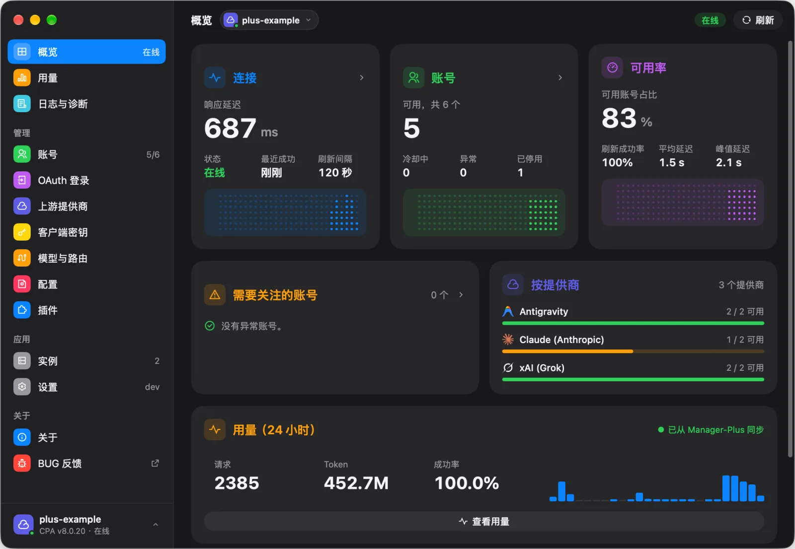
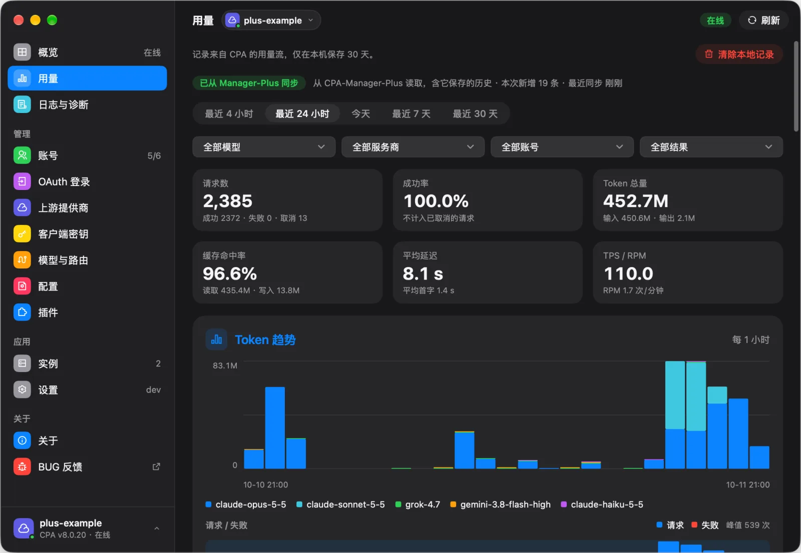
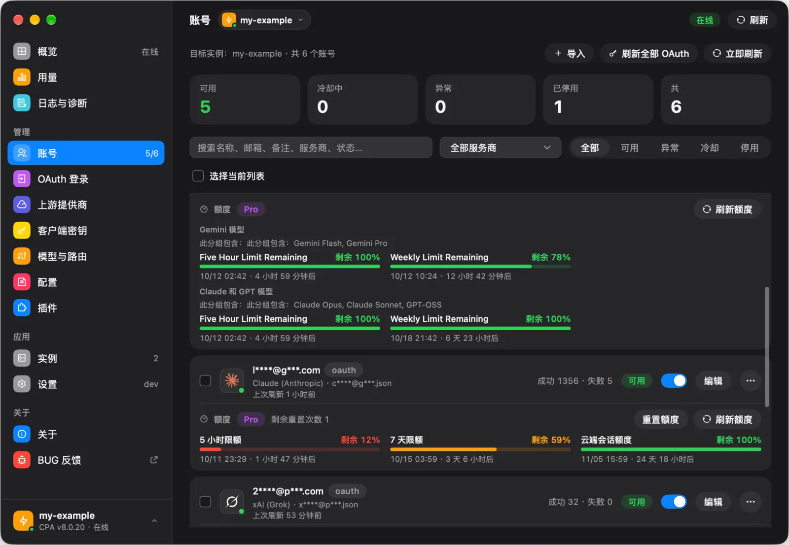
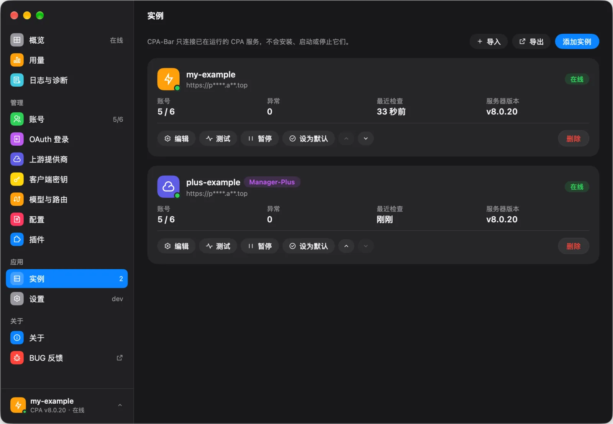
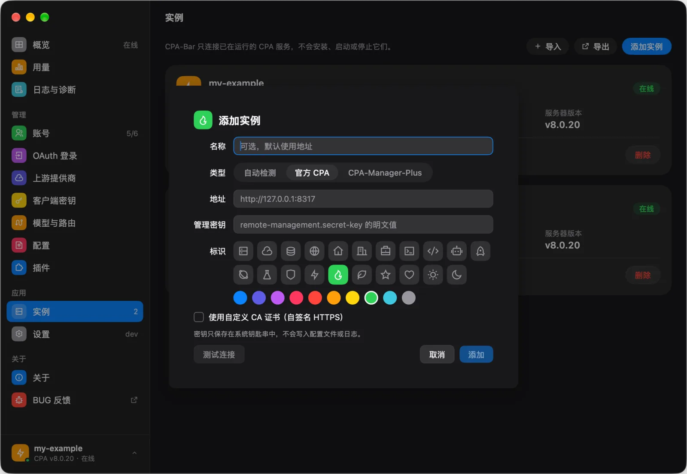
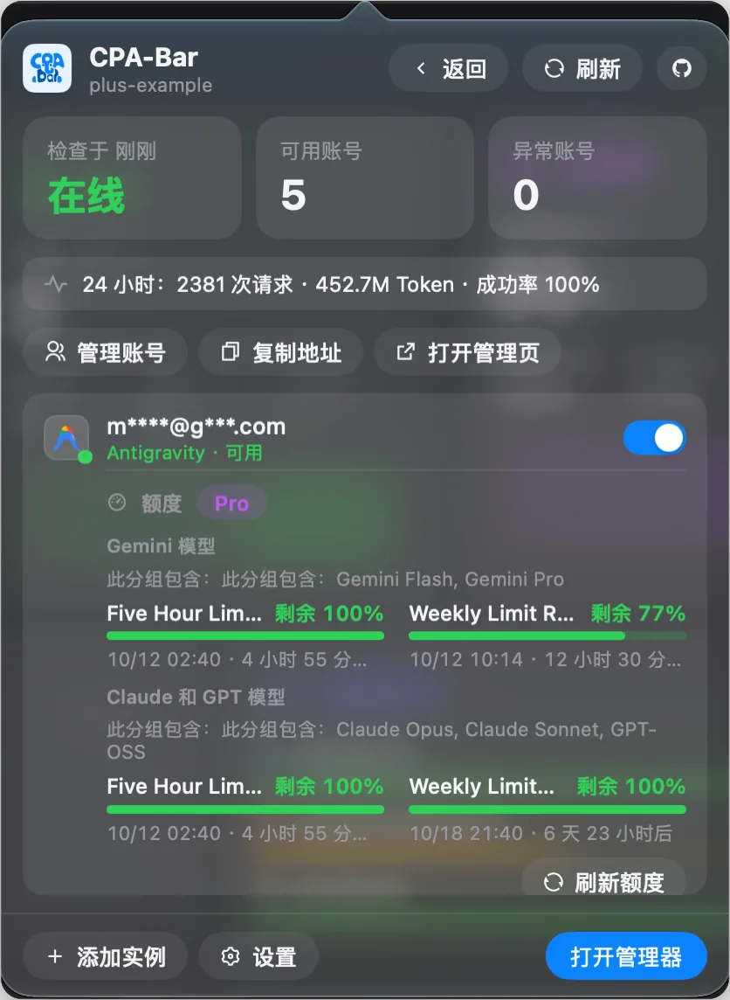

<p align="center">
  
</p>

<h1 align="center">CPA-Bar</h1>

<p align="center">
  在菜单栏里随时掌握你的 <a href="https://github.com/router-for-me/CLIProxyAPI">CLIProxyAPI</a> 服务。
</p>

<p align="center">
  <a href="README.md">English</a> · <b>简体中文</b>
</p>

---

CPA-Bar 是一个适用于 macOS、Windows 和 Linux 的原生桌面应用。它常驻在菜单栏或系统托盘，让你一眼看清各个 CLIProxyAPI（CPA）实例的状态，需要时再打开完整的管理窗口。

## 功能

- **多实例集中管理**：添加多个 CPA 服务，在托盘面板查看各自状态，并在应用中随时切换。
- **完整的管理能力**：账号、OAuth 登录、提供商与 API 密钥、配置与路由、日志和插件。
- **额度与用量**：查看各账号的剩余额度和重置时间，以及请求数、Token、延迟等统计与趋势。
- **支持 [CPA-Manager-Plus](https://github.com/seakee/CPA-Manager-Plus)**：添加实例时自动检测，读取它保存的用量历史。
- **自定义菜单栏**（macOS）：显示图标和在线实例数，或以电池、进度条显示账号额度。
- **实例标识**：为每个实例选择专属的图标和颜色。
- **注重隐私**：密钥只保存在系统钥匙串中；隐私模式可在截图时隐藏地址和账号名称；没有任何遥测。
- **应用内更新**：从 GitHub Releases 获取经过签名的更新。
- **外观与语言**：支持浅色与深色外观，以及简体中文和英文界面。

## 截图

<table>
  <tr>
    <td width="50%" align="center" valign="top">
      <b>概览</b><br>
      
    </td>
    <td width="50%" align="center" valign="top">
      <b>用量统计</b><br>
      
    </td>
  </tr>
  <tr>
    <td width="50%" align="center" valign="top">
      <b>账号与额度</b><br>
      
    </td>
    <td width="50%" align="center" valign="top">
      <b>实例管理</b><br>
      
    </td>
  </tr>
  <tr>
    <td width="50%" align="center" valign="top">
      <b>添加实例</b><br>
      
    </td>
    <td width="50%" align="center" valign="top">
      <b>菜单栏面板</b><br>
      
    </td>
  </tr>
</table>

## 系统要求

| 平台 | 要求 |
|---|---|
| macOS | macOS 12 或更新版本，Apple 芯片或 Intel。 |
| Windows | Windows 10 或更新版本，amd64 或 arm64。 |
| Linux | amd64 或 arm64，需要 GTK 3、`libayatana-appindicator3` 和一个 Secret Service 提供者（gnome-keyring 或 KWallet）。 |

CPA 服务端需要提供 v8 管理接口（已在 CLIProxyAPI v8.0.23 上测试）。

## 安装

从 [Releases](https://github.com/Licoy/CPA-Bar/releases) 下载对应平台的安装包，`SHA256SUMS` 中列出了所有文件的校验值。

macOS 应用和 Windows 安装程序使用自签名证书，macOS 应用未经 Apple 公证；系统可能阻止首次启动，需要手动放行，下面的步骤只对 CPA-Bar 放行，不需要关闭任何系统安全功能。

### macOS

1. 打开 `.dmg`，把 CPA-Bar 拖进「应用程序」。
2. 从「应用程序」打开 CPA-Bar，若被 macOS 阻止，到「系统设置 > 隐私与安全性」中点「仍要打开」，再确认「打开」；自签名无法免除首次启动时的手动放行，macOS 15 及更新版本同样如此。
3. 也可以在用 `SHA256SUMS` 核对下载文件后，只移除这个应用的隔离标记：

   ```sh
   xattr -dr com.apple.quarantine /Applications/CPA-Bar.app
   ```

### Windows

运行 `CPA-Bar Setup <版本> <架构>.exe`，按当前用户安装，不需要管理员权限。如果出现 SmartScreen 提示，点「更多信息」，再点「仍要运行」。

### Linux

安装到用户目录（支持应用内更新）：

```sh
curl -fsSL https://github.com/Licoy/CPA-Bar/releases/latest/download/install.sh | sh
```

卸载：`sh install.sh --uninstall`。Debian 和 Ubuntu 也可以使用 `.deb`，由系统包管理器负责更新：

```sh
sudo apt install ./cpa-bar_<版本>_amd64.deb
```

## 快速开始

1. 首次启动时会打开管理窗口的「实例」页，点「添加实例」。
2. 填写 CPA 地址（例如 `http://127.0.0.1:8317`）和管理密钥，点「添加」。
3. 点击托盘图标打开面板，右键查看更多操作。

如需管理其他机器上的 CPA，请在它的配置中开启 `remote-management.allow-remote` 并设置 `remote-management.secret-key`；通过公网访问时请使用 HTTPS。

## 从源码构建

需要 Go 1.27.1。

```sh
go run .
go test ./...
```

使用 mygo 打包安装包：

```sh
go run github.com/egoist/mygo/cmd/mygo@v0.4.1 build -platform darwin/arm64
```

打包时使用 `mygo.json` 中指定的签名身份；在 macOS 上没有这些身份时，可以加 `-sign -` 使用临时签名。

## 致谢

- [CLIProxyAPI](https://github.com/router-for-me/CLIProxyAPI)：CPA-Bar 所管理的代理服务。
- [CPA-Manager-Plus](https://github.com/seakee/CPA-Manager-Plus)：CPA-Bar 可读取其用量历史的管理面板。
- [mygo](https://github.com/egoist/mygo)：CPA-Bar 所使用的 Go 原生桌面应用框架。
- [Remix Icon](https://remixicon.com/)（Apache License 2.0）：界面图标。
- [LobeHub Icons](https://icons.lobehub.com/)（MIT License）：服务商标志。
