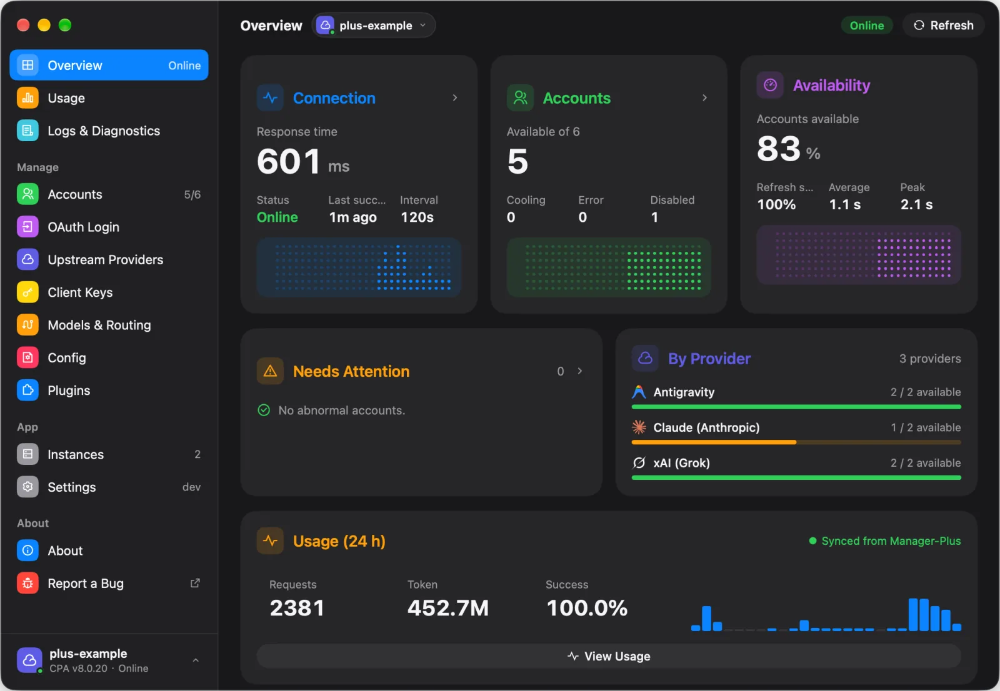
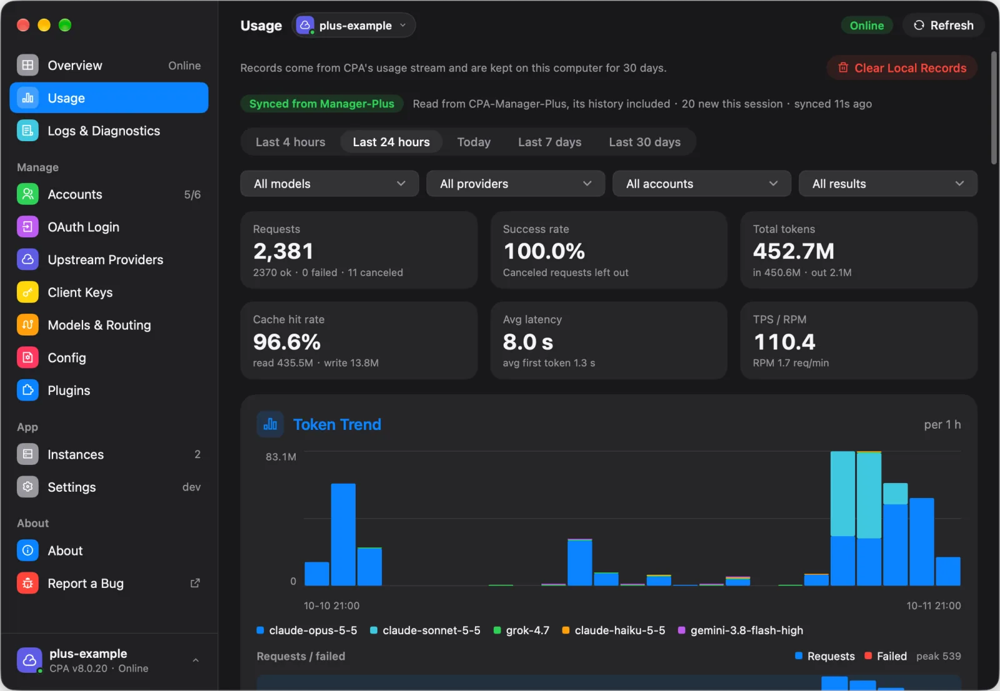
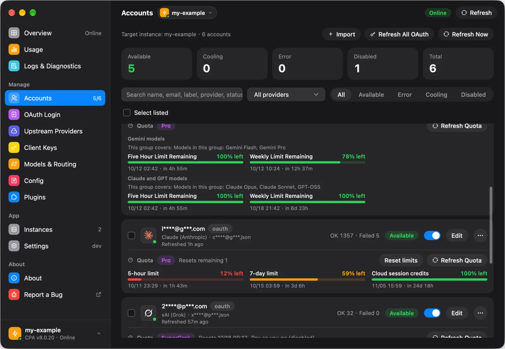
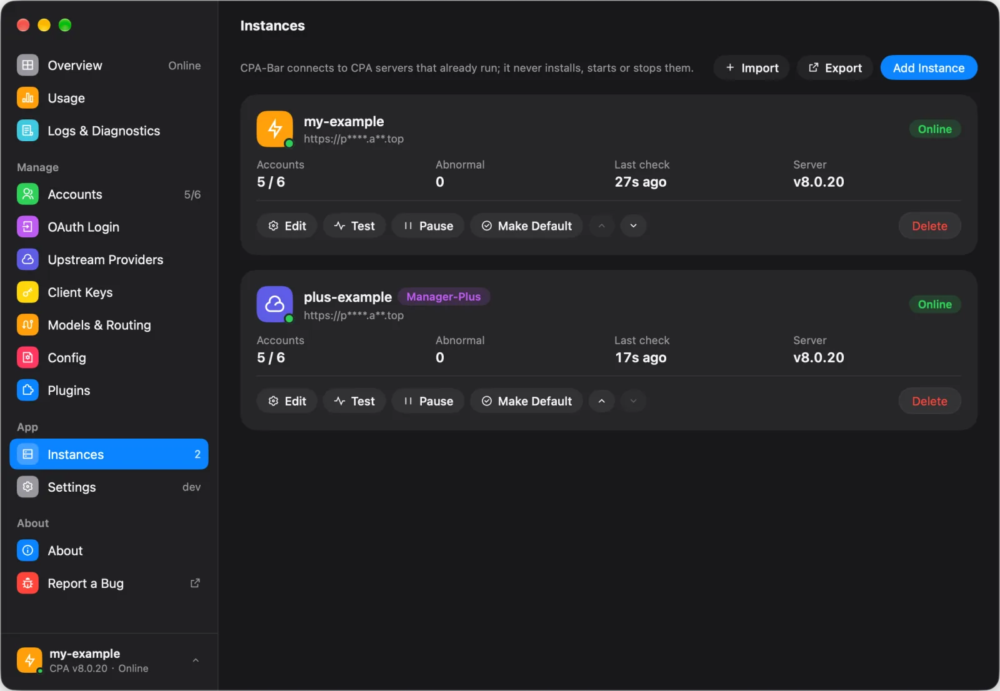
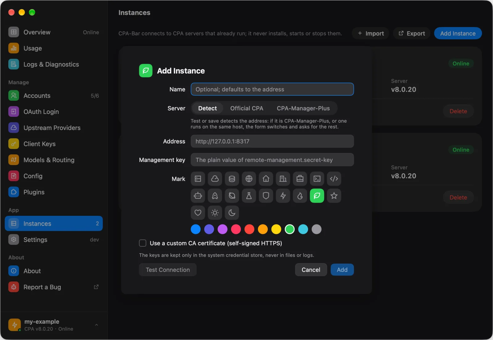
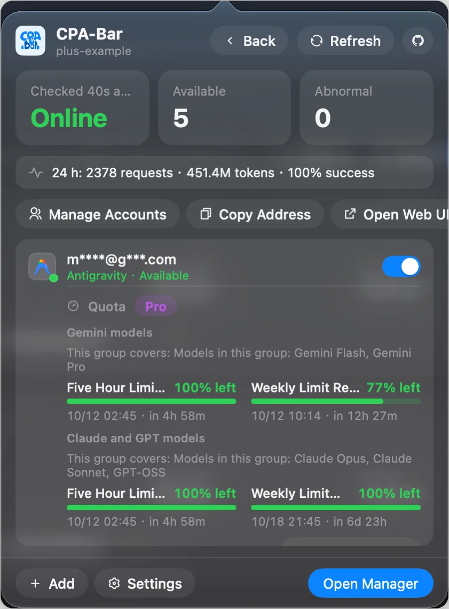

<p align="center">
  
</p>

<h1 align="center">CPA-Bar</h1>

<p align="center">
  Keep an eye on your <a href="https://github.com/router-for-me/CLIProxyAPI">CLIProxyAPI</a> servers from the menu bar.
</p>

<p align="center">
  <b>English</b> · <a href="README-ZH_CN.md">简体中文</a>
</p>

---

CPA-Bar is a native desktop app for macOS, Windows and Linux. It sits in the menu bar or system tray, shows how your CLIProxyAPI (CPA) instances are doing at a glance, and opens a full management window when you need more.

## Features

- **Many instances, one place**: add several CPA servers, see each one's status from the tray panel and switch between them anywhere in the app.
- **Full management**: accounts, OAuth sign-in, providers and API keys, configuration and routing, logs and plugins.
- **Quotas and usage**: what each account has left and when it resets, and request, token and latency statistics over time.
- **[CPA-Manager-Plus](https://github.com/seakee/CPA-Manager-Plus) support**: detected when you add an instance, for its usage history.
- **Your menu bar, your way** (macOS): the logo with the number of instances online, or the quota of two accounts as bars (pinned accounts first).
- **Instance marks**: give each instance its own icon and color.
- **Private by design**: keys stay in the system keychain, a privacy mode hides addresses and account names for screenshots, and there is no telemetry.
- **Signed in-app updates** from GitHub Releases.
- **Appearance and language**: light and dark appearance, English and Simplified Chinese.

## Screenshots

<table>
  <tr>
    <td width="50%" align="center" valign="top">
      <b>Overview</b><br>
      
    </td>
    <td width="50%" align="center" valign="top">
      <b>Usage</b><br>
      
    </td>
  </tr>
  <tr>
    <td width="50%" align="center" valign="top">
      <b>Accounts and quotas</b><br>
      
    </td>
    <td width="50%" align="center" valign="top">
      <b>Instances</b><br>
      
    </td>
  </tr>
  <tr>
    <td width="50%" align="center" valign="top">
      <b>Add an instance</b><br>
      
    </td>
    <td width="50%" align="center" valign="top">
      <b>Tray panel</b><br>
      
    </td>
  </tr>
</table>

## Requirements

| Platform | Requirements |
|---|---|
| macOS | macOS 12 or later, Apple silicon or Intel. |
| Windows | Windows 10 or later, amd64 or arm64. |
| Linux | amd64 or arm64 with GTK 3, `libayatana-appindicator3` and a Secret Service provider (gnome-keyring or KWallet). |

CPA itself needs the v8 management API (tested with CLIProxyAPI v8.0.23).

## Install

Download the package for your platform from [Releases](https://github.com/Licoy/CPA-Bar/releases). `SHA256SUMS` lists the checksums of every file.

The macOS app and Windows installers use self-signed certificates; the macOS app is not notarized by Apple. The system may block the first launch and require manual approval. The steps below allow CPA-Bar only; no system security feature needs to be turned off.

### macOS

1. Open the `.dmg` and drag CPA-Bar into Applications.
2. Open CPA-Bar from Applications. If macOS blocks it, go to **System Settings > Privacy & Security**, click **Open Anyway**, then confirm **Open**. Self-signing does not remove this first-launch requirement, including on macOS 15 and later.
3. Alternatively, after checking the download against `SHA256SUMS`, clear the quarantine flag of this app only:

   ```sh
   xattr -dr com.apple.quarantine /Applications/CPA-Bar.app
   ```

### Windows

Run `CPA-Bar Setup <version> <arch>.exe`; it installs for the current user without administrator rights. If SmartScreen appears, click **More info**, then **Run anyway**.

### Linux

Install into your user directory (supports in-app updates):

```sh
curl -fsSL https://github.com/Licoy/CPA-Bar/releases/latest/download/install.sh | sh
```

Uninstall with `sh install.sh --uninstall`. On Debian and Ubuntu you can use the `.deb` instead, which is updated by the package manager:

```sh
sudo apt install ./cpa-bar_<version>_amd64.deb
```

## Getting started

1. On first launch the management window opens on **Instances**. Click **Add Instance**.
2. Enter the CPA address (for example `http://127.0.0.1:8317`) and its management key, then click **Add**.
3. Click the tray icon to open the panel; right-click it for more.

To manage a CPA on another machine, enable `remote-management.allow-remote` and set `remote-management.secret-key` in its configuration, and use HTTPS over public networks.

## Build from source

Requires Go 1.27.1.

```sh
go run .
go test ./...
```

Package installers with mygo:

```sh
go run github.com/egoist/mygo/cmd/mygo@v0.4.1 build -platform darwin/arm64
```

Packaging signs with the identities named in `mygo.json`; on macOS, add `-sign -` for an ad-hoc signature when you do not have them.

## Acknowledgements

- [CLIProxyAPI](https://github.com/router-for-me/CLIProxyAPI): the proxy server CPA-Bar manages.
- [CPA-Manager-Plus](https://github.com/seakee/CPA-Manager-Plus): the management panel whose usage history CPA-Bar can read.
- [mygo](https://github.com/egoist/mygo): the Go framework for native desktop apps that CPA-Bar is built with.
- [Remix Icon](https://remixicon.com/) (Apache License 2.0): the interface icons.
- [LobeHub Icons](https://icons.lobehub.com/) (MIT License): the provider logos.
- [GNOME](https://www.gnome.org/): Linux desktop integration.
- [KDE](https://kde.org/): Linux desktop integration.

## Community support

- [LinuxDO](https://linux.do)

## License

CPA-Bar is licensed under the GNU Affero General Public License v3 (AGPL-3.0), see [LICENSE](LICENSE) for the full text.
